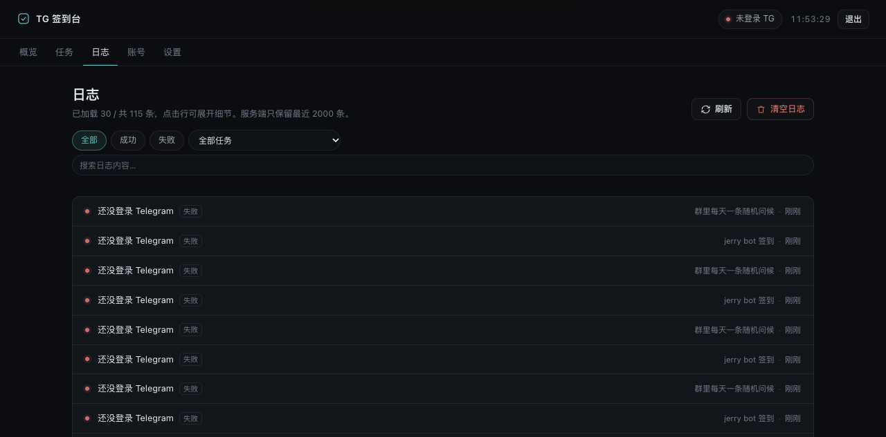
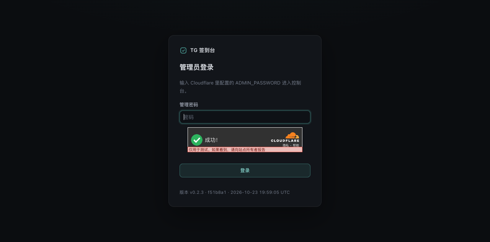
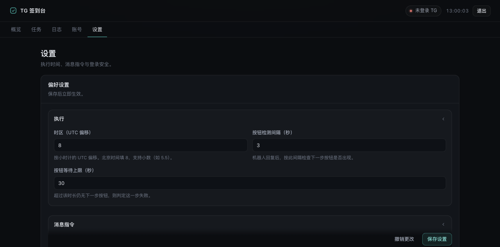

# cf-tg-checkin · TG 签到台

[](https://deploy.workers.cloudflare.com/?url=https://github.com/mihucho/cf-tg-checkin)

[](https://github.com/mihucho/cf-tg-checkin/actions/workflows/deploy.yml)
[](LICENSE)
[](https://developers.cloudflare.com/workers/)
[](CHANGELOG.md)

> **Telegram 自动签到，跑在 Cloudflare Workers 上。** 不用买 VPS、不用常驻进程，
> 在收藏夹里发一句 `9.30 签到` 就建好任务。基于 [teleproto](https://github.com/sanyok12345/teleproto)（GramJS 的活跃 fork）直连 MTProto。

<sub>**English TL;DR** — A Telegram auto check-in system running entirely on Cloudflare Workers + Durable Objects.
It speaks MTProto via `cloudflare:sockets` (no always-on server), schedules with DO alarms, stores everything in
DO SQLite, and configures tasks by sending a message like `9.30 签到` to Saved Messages. Admin dashboard included.</sub>

<p align="center">
  
  
</p>

---

## 它能做什么

| 能力 | 说明 |
| --- | --- |
| 🕘 **定时签到** | 每天固定时刻 / 时间窗口内随机 / 每 N 小时；执行前可加随机延迟，避免整点被识别 |
| 🔘 **多步骤动作** | 发文本 → 等机器人回复 → 点按钮（按文本或行列）→ 再点下一层 → 用关键词判定成功 |
| 💬 **消息即配置** | 收藏夹里发 `9.30 签到` 就建任务；转发/回复机器人消息即自动认目标（任务名取机器人的显示名） |
| 🎲 **每天一条随机消息** | `8.30-9.30 rand:早上好\|午安\|晚上好 @某个群` —— 窗口内随机时刻发一条随机内容 |
| 🖥 **管理界面** | 账号登录向导、任务编辑器、步骤日志、日志筛选分页、触发语法试算 |
| 🗄 **零额外依赖** | session / 任务 / 日志都在 Durable Object 内嵌 SQLite，不需要 D1 / KV |

---

## 快速开始

```bash
git clone https://github.com/mihucho/cf-tg-checkin.git
cd cf-tg-checkin
npm install
npx wrangler login
npx wrangler secret put ADMIN_PASSWORD    # 管理界面口令，建议 openssl rand -base64 24
npm run deploy
```

部署完打开 `https://cf-tg-checkin.<你的子域>.workers.dev`：

1. 用 `ADMIN_PASSWORD` 登录
2. 「账号」页填 `apiId` / `apiHash`（[my.telegram.org](https://my.telegram.org) 获取）+ 手机号 → 验证码 →（两步验证密码）
3. 在 Telegram **收藏夹**里发一条配置，比如：

```
9.30 签到 btn:"每日签到" #kw:签到成功
```

一分钟内会收到「✅ 已创建任务 #1」的确认（首次还会收到一份语法提示）。

> 不想用命令行？点最上面的 **Deploy to Cloudflare** 按钮，它会 fork 仓库、自动建 Durable Object、
> 并提示你填 `ADMIN_PASSWORD`。四种部署方式的细节见 **[docs/DEPLOY.md](docs/DEPLOY.md)**。

---

## 界面

| 任务列表 | 任务编辑器（动作流水线） |
| --- | --- |
|  |  |

| 日志（筛选 + 游标分页） | 登录人机验证（可选） |
| --- | --- |
|  |  |

设置 → 人机验证（Turnstile 也可以在这里配，不用改环境变量）：



---

## 触发语法

```
[时间] [动作...] [#修饰符...]
```

时间可以写在任意位置（`9 /start ...`、`https://t.me/bot 9 签到` 都认）。

**时间**

| 写法 | 含义 |
| --- | --- |
| `9` / `9点` / `9点半` / `9.30` / `09:30` / `0930` | 每天该时刻 |
| `8.30-9.30` | 每天在窗口内随机一个时刻（跨零点也支持） |
| `每30分` / `每2小时` / `every30m` / `2h` | 间隔执行 |

**动作**（按顺序执行）

| 写法 | 含义 |
| --- | --- |
| `签到` / `"签到 打卡"` | 发送文本（相邻的裸词会自动拼成一句，`📅 每日签到` 不加引号也行） |
| `btn:立即签到` | 点击文本匹配的按钮（精确 → 去图标/空格后包含 → 不区分大小写） |
| `btn:0,1` | 按行列点按钮（0 基） |
| `num:2` | 直接发数字，给只认数字选择的机器人 |
| `wait:5` | 额外等 5 秒（叠加在默认步骤间隔之上） |
| `rand:早安\|午安\|晚上好` | 随机挑一条发送 |
| `say:文本` | 强制当文本（内容里有 `:` 时用） |

**修饰符**

| 写法 | 含义 |
| --- | --- |
| `#kw:签到成功\|已签到` | 成功关键词（命中任一即成功） |
| `#delay:3` | 动作之间的间隔秒数（默认 3，`0` 关掉） |
| `#jitter:120` | 执行前随机延迟 0–120 秒 |
| `#timeout:40` | 等机器人回复的超时（秒，5–90） |
| `#delete:30` / `#clean` | 发送后删除 / 每次执行前清掉上次发的 |
| `#thread:12` | 发到群组话题 |
| `#once` / `#name:xxx` | 只执行一次 / 自定义任务名 |
| `@here` | 目标是**当前会话**（在群里发配置时不用再指定） |

**目标识别顺序**

```
消息里的 @目标 / t.me/xxx
  → 转发 / 分享来源
  → 被回复那条消息的发送者（直接回复机器人的消息即可）
  → 最近转发的机器人（先转发再单独发配置，30 分钟内有效）
  → 设置里的默认目标
```

群组 / 频道同样支持：`@群名`、`到:-1001234567890`、`@here`、或把群里消息转发到收藏夹。
私有群/频道靠 `access_hash` 解析，必要时会在执行前自动补全。

**管理命令**（发在同一个控制会话里）

```
列表            查看所有任务
立即 2          立刻跑 2 号任务（不影响下次定时）
开启 2 / 关闭 2
删除 2          也可以写任务名
帮助            查看语法
```

> 控制会话默认是收藏夹（`self`）。换成群组时记得在设置里填「管理员 tg id」，
> 否则只接受账号自己发出的触发消息（防止群里他人指挥你的账号）。

**几个现成的例子**

```
9 /start btn:个人信息 btn:签到            # 两级菜单签到
8.30-10.30 rand:早上好|午安|晚上好 @here   # 群里随机时刻发一条随机内容
每2小时 打卡 #delay:0                     # 高频、不要步骤间隔
9.30 签到 #kw:签到成功 #jitter:300        # 成功判定 + 5 分钟内随机
```

---

## 为什么能跑在 Workers 上

Telegram 的 userbot 协议是 MTProto，需要 TCP 连接；而 Workers 是无状态、会被随时驱逐的。
这个项目围绕这个矛盾做了几个取舍：

| 难点 | 做法 |
| --- | --- |
| Workers 没有 `node:net` | 自己实现 `Transport`，用 `cloudflare:sockets` 直连 Telegram DC（`src/telegram/socket.ts`） |
| workerd 禁止 `eval` / `new Function` | teleproto 用它生成 TL 字段读写器，打包时替换成解释执行版（`build/patches/fieldCodec.js`） |
| DO 会被驱逐，长连接保不住 | 每次操作重新连接（用 session 里的 auth key，1 RTT），30 秒内复用同一连接，空闲即断开 |
| 定时任务 | DO alarm 精确调度（`nextRunAt` 落库），Cron Trigger 只作兜底 |
| 收不到 updates 推送 | 不依赖推送：点按钮前轮询机器人回复，触发器轮询控制会话 |
| 无常驻连接 → 实体缓存是空的 | 目标存 `@username`/`access_hash`，实体缓存落地到 DO，失败时 `getDialogs()` 预热重试 |

---

## 部署方式

| 方式 | 一句话 | 适合 |
| --- | --- | --- |
| **一键部署按钮** | 点顶部按钮，登录 Cloudflare、填口令 | 想马上用起来 |
| **Workers Builds** | 控制台连自己的仓库，`git push` 自动部署 | 长期维护 |
| **GitHub Actions** | 仓库自带 workflow：typecheck + test + deploy | 要完整 CI |
| **本地 wrangler** | `npm run deploy` | 完全掌控 |

完整步骤、secrets 配置、排查表 → **[docs/DEPLOY.md](docs/DEPLOY.md)**

### 配置项

| 名称 | 说明 |
| --- | --- |
| `ADMIN_PASSWORD` | **必填**，管理界面口令 |
| `SESSION_SECRET` | 可选，Cookie 签名密钥（不填则复用口令） |
| `TURNSTILE_SITE_KEY` / `TURNSTILE_SECRET_KEY` | 可选，登录人机验证；也可直接在**设置页**填 |
| `TG_API_ID` / `TG_API_HASH` | 可选，把 Telegram 凭据放环境变量，省得在界面填 |
| `ALLOWED_HOSTS` | 可选，只允许这些域名访问（配合 Cloudflare Access 用） |
| `DO_LOCATION_HINT` | 可选，DO 创建区域（决定出口机房，仅创建时生效） |

> ⚠️ 口令请用 `npx wrangler secret put ADMIN_PASSWORD` 设置。
> **不要**在控制台变量页点「保存并部署」—— 那会重传脚本，可能撞上 `does not export class 'TgAgent'`
> （原因与恢复见 [docs/DEPLOY.md](docs/DEPLOY.md#报错does-not-export-class-tgagent)）。

---

## 常见问题

**"空闲/待连接"状态下还能从 Telegram 建任务吗？** 能。触发器轮询由 DO alarm 驱动，到点会现场连接
（session 里的 auth key，1 RTT）、读完消息再断开；"空闲"只表示此刻没有 socket，最迟一个轮询周期
（默认 60 秒，可调）就会生效。前提是**登录了 Telegram 且开了「允许用 Telegram 消息管理任务」**。

**需要服务器吗？** 不需要。整套东西跑在 Cloudflare 上，免费额度对个人足够（DO 请求 + 每次执行一次连接）。

**会被 Telegram 封号吗？** 换 IP 本身不是封号因素；风险在"机房 IP 登录用户账号"和异常行为（群发/刷量）。
单人一天签几次到远低于阈值。详见下面「关于 IP / 封号风险」。

**能多账号吗？** 一个部署对应一个账号。多账号就部署多份（改 `name`），或把 DO 改成按账号分片。

**和 tg-signer 有什么区别？** tg-signer 需要一台常驻机器（VPS/树莓派）跑 Python；这里零运维、不用机器，
代价是单次执行延迟高一些、不支持 AI 识图这类重活。

**改代码后怎么上线？** `npm run deploy`，或 push 到已连接的仓库。用 `/api/version` 或页面底部确认版本。

---

## 已知限制

- **单账号**：一个部署一个 Telegram 账号
- **DO 驱逐**：执行途中被驱逐会失败（日志可见），下一次 alarm 会正常重连
- **按钮类型**：支持 callback 与 reply keyboard（按文本发送）；`url`/`webview`/`switch_inline` 会跳过并记日志
- **触发延迟**：触发消息最多延迟一个轮询周期（默认 60 秒，可在设置里调，最低 15 秒）
- **flood wait**：Telegram 限流时直接失败并记日志，不做长时间等待（避免占满 DO 时间）
- **DC 迁移**：账号不在 DC2 时自动切到目标 DC 并记住；若提示重新取码，再点一次「获取验证码」即可

## 关于 Telegram 侧的 IP / 封号风险

| 事实 | 结论 |
| --- | --- |
| DO 是**单实例、固定区域**的，不会每次请求换机房 | 「热切换」只发生在驱逐/迁移时，不是常态 |
| 迁移后出口 IP 可能换机房 | Telegram 对换 IP 很宽容（手机网络一天换几十次） |
| 出口是数据中心 IP | 偶尔会要求重新验证，官方 App 点一下即可；这不是封号 |
| 真正的诱因 | 群发/刷量/多账号共用 apiId/突增请求 |
| `AUTH_KEY_DUPLICATED` | 同 auth key 多 IP 并发才触发；DO 单实例 + 30 秒复用已把并发降到最低 |

想固定出口区域（**只在 DO 创建时生效**）：

```bash
npx wrangler deploy --var DO_LOCATION_HINT:apac   # apac/enam/weur/eeur/me/afr/oc/sam
```

「设置 → 关于」会显示 `出口机房 SIN · DO 区域 apac`，方便确认。

---

## 安全

完整威胁模型、渗透实测记录与残余风险 → **[SECURITY.md](SECURITY.md)**

- 口令 + HMAC 签名的 HttpOnly Cookie（7 天有效，10 次失败/10 分钟锁定）
- 可选 **Cloudflare Turnstile** 人机验证（设置页填 Key 即可，Secret 只存服务端、不回传）
- 状态变更接口校验 `Origin`，CSP / nosniff / X-Frame-Options 等安全头齐全
- 建议再叠一层 **Cloudflare Access** 并把 `ALLOWED_HOSTS` 设成你的自定义域名（否则 workers.dev 会绕过 Access）
- Telegram session 只存在你自己的 Durable Object 里

---

## 开发

```bash
cp .dev.vars.example .dev.vars   # 填 ADMIN_PASSWORD
npm run dev                      # wrangler dev（自定义构建自动打包 + watch src/）
npm test                         # 调度 / 触发语法 / 按钮 / 实体解析 单测（40+ 个）
npm run check                    # typecheck + test + build + 产物导出自检
```

- 触发语法 `src/schedule/dsl.ts`（改语法请顺手补 `tests/schedule.test.ts`）
- 调度算法 `src/schedule/time.ts`（纯函数，不依赖 Intl 时区库）
- 动作执行器 `src/telegram/executor.ts`（发消息 / 轮询 / 点按钮 / 判定）
- 管理界面 `public/`（纯静态、无构建、无 CDN 依赖）
- 版本号只在 `package.json`：构建时注入产物，页面底部与 `GET /api/version` 都用它；
  发版跑 `npm version patch`（详见 [CHANGELOG.md](CHANGELOG.md)）

> 本地 workerd 能真的连 Telegram（`cloudflare:sockets` 本地可用），登录流程可在本地跑通。

<details>
<summary>目录结构</summary>

```
src/
├── index.ts              Worker 入口：登录 Cookie、/api 路由、Cron 兜底
├── agent.ts              Durable Object：session、调度、触发器、执行、API
├── db.ts                 内嵌 SQLite：tasks / logs / kv / 登录限速 / 延迟删除
├── types.ts env.ts version.ts
├── telegram/             socket / transport / client / executor / targets
└── schedule/             time.ts（调度计算）dsl.ts（触发语法）
public/                   管理界面（纯静态）
build/patches/            teleproto 的 no-eval 补丁
tests/                    纯逻辑单测
docs/API.md               前后端接口契约
docs/DEPLOY.md            部署、secrets、排查表
SECURITY.md               安全审计记录
```
</details>

---

## 参考 / 致谢

- [amchii/tg-signer](https://github.com/amchii/tg-signer) —— 动作流水线、`sign_at` + `random_seconds` 的思路
- [ssfun/tg-sign-plus](https://github.com/ssfun/tg-sign-plus) —— `fixed/range` 调度、动作代码化
- [teleproto](https://docs.teleproto.dev) —— MTProto 客户端（本项目在其之上实现了 Workers 传输层）
- [core.telegram.org](https://core.telegram.org/api) —— `messages.getBotCallbackAnswer`、`ReplyInlineMarkup` 等

## License

[MIT](LICENSE) · Issue / PR 都欢迎
