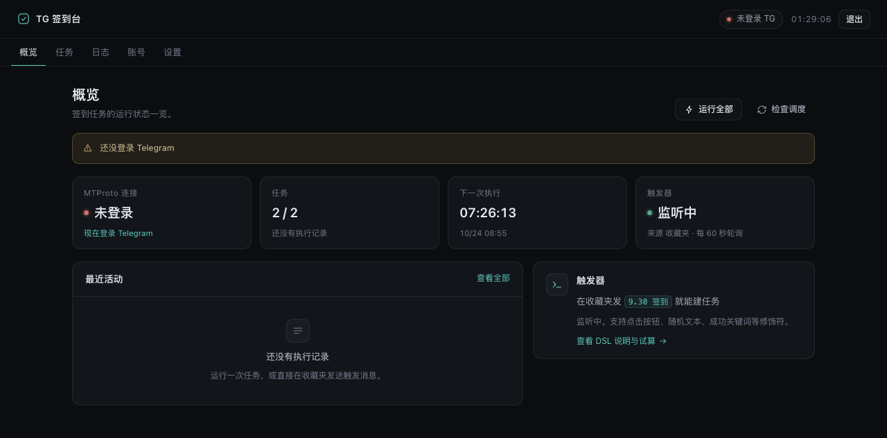
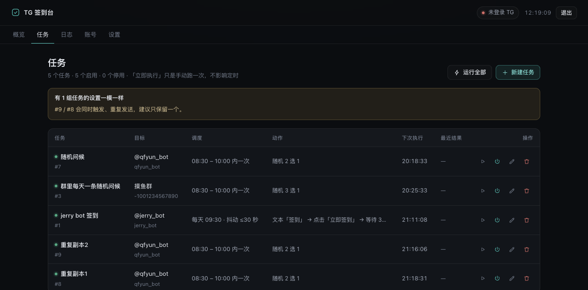
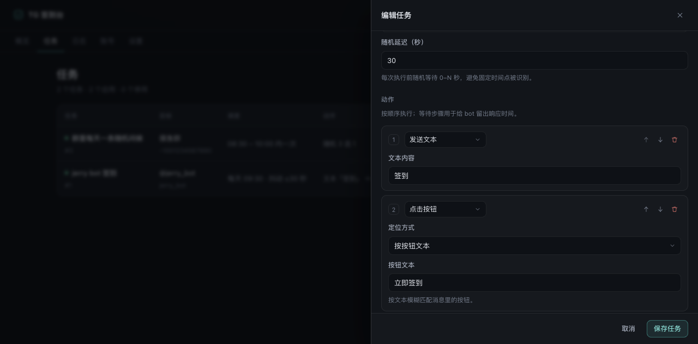

# cf-tg-checkin · TG 签到台

[](https://deploy.workers.cloudflare.com/?url=https://github.com/mihucho/cf-tg-checkin)

[](https://github.com/mihucho/cf-tg-checkin/actions/workflows/deploy.yml)
[](LICENSE)
[](https://developers.cloudflare.com/workers/)

跑在 **Cloudflare Workers + Durable Objects** 上的 Telegram 自动签到系统，用
[teleproto](https://github.com/sanyok12345/teleproto)（GramJS 的活跃 fork）直连 MTProto，
不依赖任何常驻服务器。

- 🕘 **定时签到**：每天固定时间 / 时间窗口内随机 / 每 N 小时，支持执行前随机延迟
- 🔘 **多步骤动作**：发文本 → 等回复 → 点按钮（按文本或行列）→ 再点下一层 → 判定成功关键词
- 💬 **消息即配置**：往收藏夹发一条 `9.30 签到`，就建了一个每天 9:30 给它签到的任务；
  转发/分享机器人消息、或**直接回复**那条机器人消息，都会自动认出去给谁签到
- 🎲 **每天一条随机消息**：`8.30-9.30 rand:早上好|午安|晚上好 @某个群`，窗口内随机时刻发一条随机内容
- 🖥 **管理界面**：账号登录向导、任务 CRUD、执行日志、触发语法试算
- 🗄 **零额外依赖**：session / 任务 / 日志都在 Durable Object 内嵌 SQLite 里，不需要 D1 / KV

---

## 为什么这样设计

Telegram 的 userbot（用户账号）协议是 MTProto，需要 TCP 长连接。Workers 的执行模型和它八字不合，
所以这里的几个关键取舍：

| 问题 | 做法 |
| --- | --- |
| Workers 没有 `node:net` | 自己实现 `Transport`，用 `cloudflare:sockets` 的 `connect()` 直连 Telegram DC（见 `src/telegram/socket.ts`） |
| workerd 禁止 `eval` / `new Function` | teleproto 用 `new Function` 生成 TL 字段读写器，打包时追加一份解释执行实现覆盖它（`build/patches/fieldCodec.js`） |
| Durable Object 会被驱逐，长连接保不住 | **每次操作重新连接**：DO alarm 醒来 → 连上（用 session 里的 auth key，1 RTT）→ 干活 → 断开 |
| 定时任务 | DO alarm 做精确调度（`nextRunAt` 落库），Cron Trigger 只作兜底 |
| 收不到 updates 推送 | 不依赖推送：点按钮前用 `messages.getHistory` 轮询机器人回复；触发器靠轮询控制会话 |

---

## 部署

四种方式，任选其一；完整步骤、secrets 配置和排查表见 **[docs/DEPLOY.md](docs/DEPLOY.md)**。

| 方式 | 一句话 | 适合 |
| --- | --- | --- |
| **① 一键部署按钮** | 点上面那个 Deploy 按钮，登录 Cloudflare、填口令就完事 | 想马上用起来 |
| **② Workers Builds** | 控制台连自己的 GitHub 仓库，`git push` 自动构建部署 | 长期维护 |
| **③ GitHub Actions** | 仓库自带 workflow：类型检查 + 单测 + 部署 | 要完整 CI |
| **④ 本地 wrangler** | `npm install && npx wrangler login && npm run deploy` | 完全掌控 |

### 本地手工部署（最快的自测路径）

```bash
git clone https://github.com/mihucho/cf-tg-checkin.git
cd cf-tg-checkin
npm install
npx wrangler login
npx wrangler secret put ADMIN_PASSWORD     # 管理界面登录口令
npm run deploy                             # 打包 + 部署
```

`wrangler.jsonc` 里配了 `build.command`，所以 `wrangler deploy` / `wrangler dev`
都会自动跑一遍 esbuild，不会出现「忘了构建」的问题。

### 部署后 3 步

1. 打开 `https://cf-tg-checkin.<你的子域>.workers.dev`，用 `ADMIN_PASSWORD` 登录
2. 「账号」页填 `apiId` / `apiHash` / 手机号（含国家码）→ 验证码 →（两步验证密码）
3. 在 Telegram 收藏夹里发 `9.30 签到`，或者直接在管理界面新建任务

### 可选 secret / 变量

| 名称 | 作用 |
| --- | --- |
| `ADMIN_PASSWORD` | **必填**，管理界面登录口令（`openssl rand -base64 24`） |
| `SESSION_SECRET` | 登录 Cookie 的 HMAC 密钥，不填则复用 `ADMIN_PASSWORD` |
| `TG_API_ID` / `TG_API_HASH` | 把 Telegram 应用凭据放环境变量，省得在界面填 |

> 口令用 `npx wrangler secret put ADMIN_PASSWORD` 设置。
> **不要**控制台变量页点「保存并部署」——那会重传脚本，可能撞上
> `does not export class 'TgAgent'`（原因与恢复见 [docs/DEPLOY.md](docs/DEPLOY.md#报错does-not-export-class-tgagent)）。

### 本地开发

```bash
cp .dev.vars.example .dev.vars    # 填 ADMIN_PASSWORD
npm install
npm run dev                       # wrangler dev（自定义构建自动打包并 watch src/）
npm test                          # 调度 / 触发语法 / 按钮解析单测
npm run typecheck
npm run check                     # typecheck + test + build
```

> 本地 workerd 也能真的连 Telegram（`cloudflare:sockets` 本地可用），登录流程可以在本地跑通。

## 界面

| 概览 | 任务 |
| --- | --- |
|  |  |

任务编辑器（动作流水线，按顺序执行）：



## 触发语法

```
[时间] [动作...] [#修饰符...]
```

**时间**

| 写法 | 含义 |
| --- | --- |
| `9.30` / `09:30` / `0930` / `21：05` | 每天该时刻 |
| `8.30-9.30` | 每天在窗口内随机一个时刻（跨零点也支持） |
| `每30分` / `每2小时` / `every30m` / `2h` | 间隔执行 |

**动作**（按顺序执行）

| 写法 | 含义 |
| --- | --- |
| `签到` / `"签到 打卡"` | 发送文本（含空格用引号） |
| `say:文本` | 同上，强制当文本（即使内容里有 `:`） |
| `btn:立即签到` | 点击文本匹配的按钮（先精确、再包含、再不区分大小写） |
| `btn:0,1` | 按行列点按钮（0 基，行,列） |
| `num:2` | 直接发数字，给只认数字选择的机器人 |
| `wait:5` | 额外等 5 秒（叠加在默认步骤间隔之上） |
| `rand:早安\|午安\|晚上好` | 随机挑一条发送（「每天一条随机消息」就用它） |

**修饰符**

| 写法 | 含义 |
| --- | --- |
| `#kw:签到成功\|已签到` | 成功关键词（命中任一即算成功） |
| `#jitter:120` | 执行前随机延迟 0-120 秒 |
| `#once`（或 `once`） | 只执行一次，跑完自动禁用 |
| `#delete:30` | 发送后 30 秒删掉自己发的消息 |
| `#clean` | 每次执行前删掉上一次发的消息 |
| `#timeout:40` | 等待机器人回复的超时（秒，5-90） |
| `#delay:3` | 每个动作之间的间隔秒数（默认 3，`#delay:0` 关掉） |
| `#thread:12` | 发到群组话题（message_thread_id） |
| `#name:名称` | 覆盖自动生成的任务名 |

典型的两级菜单签到（9 点发 `/start`，再依次点「个人信息」「签到」）：

```
9 /start btn:个人信息 btn:签到
```

每个动作之间默认停 3 秒（`#delay:5` 可调、`#delay:0` 关掉）；
等下一步菜单出现时默认 **每 3 秒检测一次、最多等 30 秒**，这两项在「设置 → 步骤检测」里可调
（`stepPollSeconds` / `stepWaitSeconds`）。机器人改版换菜单时只要改按钮文本即可。

**目标**

优先级：消息里写的 `@目标` / `到:-1001234567890` / `t.me/xxx` → **转发/分享来源** →
**被回复的那条消息的发送者**（直接回复机器人的消息即可）→ 设置里的「默认目标」。

**管理命令**（同样发在控制会话里）

```
列表          查看所有任务
立即 2        立刻跑 2 号任务
开启 2 / 关闭 2
删除 2        也可以写任务名
帮助          看语法
```

> 控制会话默认是「收藏夹」（`self`）。如果换成群组，记得在设置里填「管理员 tg id」，
> 否则群里任何人发消息都能建任务。

---

## 管理界面

| Tab | 能力 |
| --- | --- |
| 概览 | 连接状态、任务数量、下一次执行倒计时、最近日志、触发语法速查 |
| 任务 | 列表 / 新建 / 编辑（调度 + 动作流水线）/ 立即执行 / 启停 / 删除 |
| 日志 | 每次执行的成功失败、命中关键词、每步细节（含每步等待与检测次数） |
| 账号 | apiId/apiHash/手机号 → 验证码 → 两步验证 的分步向导，退出登录 |
| 设置 | 时区偏移、触发轮询间隔、步骤检测（检测间隔 / 最多等待）、控制会话、管理员 id、默认目标 |

---

## 目录结构

```
src/
├── index.ts              Worker 入口：登录 Cookie、/api 路由、Cron 兜底
├── agent.ts              Durable Object：session、调度（alarm）、触发器、任务执行、API
├── db.ts                 DO 内嵌 SQLite：tasks / logs / kv / 延迟删除
├── types.ts              共享类型（前端契约见 docs/API.md）
├── env.ts                绑定声明
├── telegram/
│   ├── socket.ts         cloudflare:sockets → teleproto SocketInterface
│   ├── transport.ts      自定义 Transport
│   ├── client.ts         TelegramClient 工厂
│   └── executor.ts       发消息 / 等回复 / 点按钮 / 判定成功 / 清理
├── schedule/
│   ├── time.ts           时区、下次执行时间计算
│   └── dsl.ts            触发消息解析器
public/                   管理界面（纯静态，无构建、无 CDN 依赖）
build/patches/            teleproto 的 no-eval 补丁
tests/schedule.test.ts    调度 / 触发语法 / 按钮解析单测
docs/API.md               前后端接口契约
docs/DEPLOY.md            四种部署方式的完整步骤与排查表
.github/workflows/        CI（typecheck + test + build）与部署
```

---

## 参考的开源项目

设计上参考了这些项目的任务模型与触发方式：

- [amchii/tg-signer](https://github.com/amchii/tg-signer) —— 动作流水线（发文本 / 点键盘 / 等待 / 关键词判定）、
  `sign_at` + `random_seconds` 的思路
- [ssfun/tg-sign-plus](https://github.com/ssfun/tg-sign-plus) —— `execution_mode: fixed/range`（窗口内随机）、
  chat 级事件参数、动作代码化
- [Telegram Bot API 文档](https://core.telegram.org/api) 与 [teleproto](https://docs.teleproto.dev) ——
  `messages.getBotCallbackAnswer` 点击 inline 按钮、`ReplyInlineMarkup` 结构

---

## 已知限制

- **单账号**：一个部署对应一个 Telegram 账号（多账号可以部署多份，或改造成多个 DO 实例）
- **DO 驱逐**：执行过程中如果 DO 被驱逐，任务会失败并能从日志看到；下一次 alarm 会正常重连
- **按钮类型**：支持 callback 按钮和 reply keyboard（发文本）；`url`、`webview` 按钮点不了
- **轮询间隔**：默认 60 秒（最低 30 秒），意味着触发消息最多延迟一分钟才生效
- **flood wait**：Telegram 限流时任务直接失败并记日志，不做自动长时间等待（避免占满 DO 时间）
- **DC 迁移**：账号不在 DC2 时登录会收到 `PHONE_MIGRATE_n`，程序自动切到目标 DC 重试并记住；若提示重新取码，点一次「获取验证码」即可
- **费用**：DO 请求 + 每次 alarm 的连接，免费额度基本够个人用；轮询越密消耗越大

## 安全

- 管理界面用一个口令 + HMAC 签名的 HttpOnly Cookie；生产建议再叠一层 Cloudflare Access
- Telegram session（等价于登录态）加密前后都只存在你自己的 Durable Object 里
- 触发消息会真的往目标聊天发消息，请确认控制会话里的人可信

## 开发与贡献

```bash
npm run check     # typecheck + 单测 + 打包，一条命令确认没坏
npm test          # 只跑调度 / 语法 / 按钮解析的单测
```

- 触发语法在 `src/schedule/dsl.ts`，改语法请顺手补 `tests/schedule.test.ts`
- 调度时间算法在 `src/schedule/time.ts`（纯函数，不依赖 Intl 时区库）
- 动作执行器在 `src/telegram/executor.ts`（发消息 / 轮询按钮 / 点击 / 判定）
- 管理界面是 `public/` 下的纯静态文件，改完刷新即可，没有构建步骤
- 版本号只在 `package.json` 里维护：构建时注入产物，页面底部、`GET /api/version`
  和 Telegram 客户端上报的 appVersion 都用它；发版跑 `npm version patch`（详见 [CHANGELOG.md](CHANGELOG.md)）

Issue / PR 都欢迎。

## License

[MIT](LICENSE)
